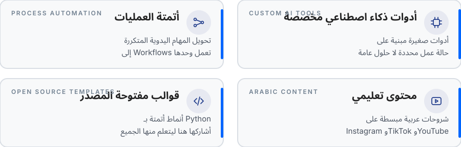
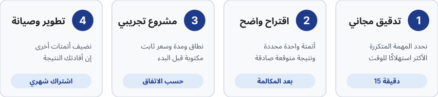
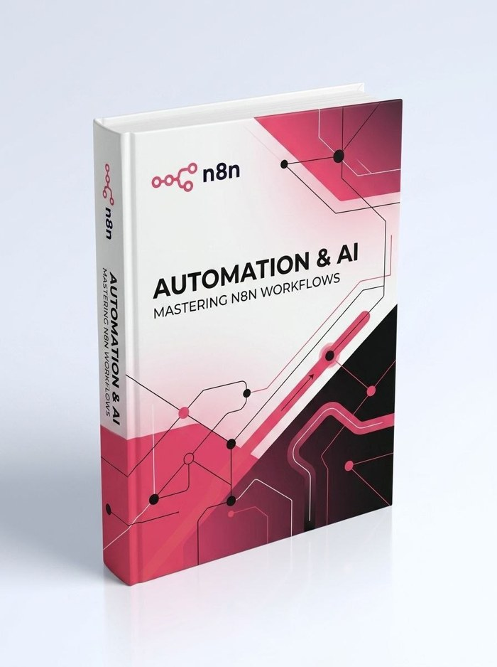

 

 

أنا **Rayane (Moh)** من الجزائر، أبني **أتمتة وأدوات ذكاء اصطناعي** تُنهي على أصحاب الشركات ساعات من العمل المتكرر، وأصنع محتوى عربيًا يشرح كيف يستفيد أي صاحب مشروع من الذكاء الاصطناعي دون تعقيد.

**ما أقوله عن نفسي بلا مبالغة:**

- أشتغل في الذكاء الاصطناعي منذ **أكثر من سنتين**
- قضيت **أكثر من 400 ساعة** في هندسة الأوامر (Prompt Engineering) داخل أكواد AI باستخدام **Python**
- وجهتي: أن أصبح **مهندس ذكاء اصطناعي**، وأتعلم بالبناء الفعلي لا بالنظرية فقط
- أتفرغ لمشروعي بدوام كامل، وأوثّق كل خطوة علنًا
- أستهدف السوق **العربي كله**، وأكتب بعربية مبسّطة يفهمها الجميع

**أين أنا الآن بصدق:** أبني الإثبات قبل البيع. لم أسلّم بعد مشاريع لعملاء، ولن أدّعي ذلك. أرفع هنا قوالب حقيقية وأوثّق تجاربي، وأول المشاريع التجريبية ستكون بشروط واضحة وبإذن كتابي قبل ذكر أي نتيجة.

 

**أمثلة على المهام التي تصلح للأتمتة** (أنواع مهام، وليست مشاريع سلّمتها):

| نوع المهمة | كيف يمكن للأتمتة أن تساعد |
|---|---|
| الرد على الرسائل والاستفسارات المتكررة | صياغة ردود أولية جاهزة تُراجَع قبل الإرسال |
| تلخيص المستندات والاجتماعات | تحويل نص طويل إلى نقاط وقرارات مطلوبة |
| تجهيز التقارير الدورية | جمع الأرقام من مصدرها وترتيبها في صيغة ثابتة |
| إدخال البيانات ونقلها بين الأدوات | إلغاء النسخ واللصق اليدوي وتقليل الأخطاء |
| تحويل المحتوى إلى صيغ متعددة | فيديو واحد يصبح نصًا ومنشورًا وملخصًا |

القاعدة عندي: أبدأ بالمهمة التي **تتكرر كل يوم وتأخذ أطول وقت**، لا بالأدوات الأحدث.

 

**كيف أستخدمها عمليًا:**

- **n8n:** لبناء الـ Workflows التي تربط الأدوات وتشغّل المهام تلقائيًا
- **Claude (claude.ai):** للتفكير في الحل وكتابة الأوامر وتجريبها وتلخيص المستندات
- **Claude Code:** لكتابة أكواد Python واختبارها وإصلاحها داخل المشاريع
- وأدوات ذكاء اصطناعي أخرى حسب حاجة كل مهمة، وأختار الأداة بحسب المهمة لا بحسب الموضة

 

**ماذا يحدث في مكالمة التدقيق المجانية (15 دقيقة):**

| الدقائق | المحتوى |
|---|---|
| 2 | تعريف بي وبهدف المكالمة |
| 6 | أسئلة عن نشاطك والمهمة المتكررة، وأستمع أكثر مما أتكلم |
| 4 | اقتراح أتمتة واحدة، وكيف تُنفَّذ، والنتيجة المتوقعة بأرقام تقديرية صادقة |
| 3 | العرض والخطوة التالية بموعد محدد |

**ما أحتاج معرفته منك:** نشاط شركتك، المهمة التي تأخذ أكثر وقت، كم شخصًا يقوم بها وكم ساعة أسبوعيًا، الأدوات التي تستخدمونها الآن، وهدفك خلال 3 أشهر.

> قبل أي مشروع: اتفاق مكتوب يحدد النطاق والسعر والمدة والتسليم وطريقة الدفع.

 

| المستوى | ما يشمله | لمن يناسب |
|---|---|---|
| **1. مجاني** | تدقيق 15 دقيقة + [الكتاب المجاني](https://n8nbook.netlify.app) | من لا يعرف أي مهمة يبدأ بأتمتتها |
| **2. مشروع تجريبي بسعر ثابت** | أتمتة واحدة محددة النطاق والمدة والتسليم | من يريد تجربة النتيجة قبل الالتزام |
| **3. اشتراك شهري** | صيانة وتطوير أتمتات إضافية | من أفادته التجربة ويريد التوسع |

**كيف أحدد السعر:** أبدأ من قيمة النتيجة لك (الساعات الموفّرة × تكلفة الساعة)، لا من عدد ساعاتي أنا. وأول المشاريع ستكون بسعر رمزي مقابل دراسة حالة وشهادة حقيقية، بإذن كتابي منك.

 

### أتمتة الأعمال بالذكاء الاصطناعي: Mastering n8n Workflows

حقيبة تعليمية **مجانية** كتبتها بالعربية، تأخذك من فهم الفكرة إلى نظام أتمتة يعمل عند عميل حقيقي، دون خبرة برمجية سابقة.

| ماذا تجد فيها | التفصيل |
|---|---|
| **11 مرحلة** تعليمية | من «ما هو AI Automation» إلى النشر والصيانة، وتمرين تطبيقي في نهاية كل ملف |
| **20 قالب** Workflow جاهز | ملفات JSON تستوردها مباشرة في n8n، بثلاثة مستويات: Automation وAI Automation وAI Agent |
| **6 نيشات** مع Prompts جاهزة | عيادات، عقارات، متاجر إلكترونية، مكاتب قانونية ومحاسبية، وكالات تسويق، وخدمات محلية |
| **4 وكلاء** داخل Claude Code | خط إنتاج: architect ثم developer ثم reviewer ثم docs |
| **خارطة الوصول لأول عميل** | البحث عن العملاء، والتسعير، ومكالمة البيع، والاعتراضات الشائعة، والتسليم |

**لمن هي؟** للمبتدئ وصانع المحتوى والمستقل وصاحب الخدمات الرقمية الذي يريد دخول مجال الأتمتة.

[**احصل على الكتاب مجانًا ←**](https://n8nbook.netlify.app)

 

**ما لا أفعله:**

- لا أعد بنتائج مضمونة، ولا أذكر أرقامًا لم تتحقق
- لا أذكر اسم عميل أو نتيجته دون إذن كتابي
- لا أطلب بيانات حساسة منك إلا عند الضرورة، ولا أرفع مفاتيح API ولا بيانات العملاء
- أعمل في **الحلال فقط**، وأرفض كل ما فيه غش أو ربا أو مقامرة أو محتوى غير لائق

 

| الأولوية | الهدف | الحالة |
|---|---|---|
| 1 | رفع **قوالب أتمتة بـ Python** مع README لكل قالب (المشكلة، الحل، التشغيل) | قيد البناء |
| 2 | كتابة **دراسة حالة** عن أتمتة طبّقتها على مشروعي الخاص بأرقام حقيقية | قريبًا |
| 3 | أول مشاريع تجريبية مع عملاء مقابل شهادة وإثبات مكتوب | مخطط |
| 4 | الانتقال تدريجيًا نحو مشاريع هندسة الذكاء الاصطناعي | هدف طويل المدى |

> هذه خارطة طريق معلنة وليست إنجازات. أحدّث الحالة هنا كلما أنهيت شيئًا فعلًا.

**ما سيحتويه كل قالب أرفعه هنا:** وصف المشكلة التي يحلها، والحل خطوة بخطوة، وطريقة التشغيل، وما لا يفعله القالب، دون أي مفتاح API أو بيانات حقيقية.

 

| الركيزة | الهدف |
|---|---|
| **جذب** | أفكار سريعة تشرح الذكاء الاصطناعي للجميع |
| **ثقة** | شروحات أعمق عن الأتمتة وكيف تعمل |
| **إثبات** | ما أبنيه وأتعلمه بالتفصيل، بصدق وبلا مبالغة |

**الوتيرة:** 3 ريلز أسبوعيًا (واحد من كل ركيزة) + فيديو يوتيوب شهريًا، بالعربية المبسّطة.

**أين تجدني:** الريلز على [Instagram](https://instagram.com/moh_rayano) و[TikTok](https://tiktok.com/@moh_rayano)، والشروحات الأطول على [YouTube](https://youtube.com/@moh_rayano)، والأفكار المختصرة على [X](https://x.com/moh_rayano)، والجانب المهني على [LinkedIn](https://linkedin.com/in/moh-rayano)، والأكواد والقوالب هنا على [GitHub](https://github.com/mohrayano).

 

**هل الأتمتة مكلفة؟**
نبدأ بتدقيق مجاني، ثم مشروع تجريبي صغير بسعر ثابت متفق عليه مسبقًا. أحسب لك القيمة من الساعات التي ستوفرها، فإن لم تكن الأتمتة مجدية فسأقول لك ذلك.

**لا أثق في الذكاء الاصطناعي، ماذا عن الأخطاء؟**
لهذا أعتمد المراجعة البشرية في كل قرار مهم: الذكاء الاصطناعي يجهّز ويقترح، وأنت من يقرر. ويمكنني أن أعرض لك تجربة قصيرة على بيانات وهمية قبل أي التزام.

**هل بياناتي في أمان؟**
لا أرفع بيانات العملاء ولا مفاتيح API إلى أي مكان عام، ولا أطلب إلا الضروري لتنفيذ المهمة.

**هل سلّمت مشاريع لعملاء من قبل؟**
لا، وأقولها بوضوح. ولهذا أبني الإثبات علنًا بقوالب مفتوحة ودراسة حالة على مشروعي، وأعرض أول المشاريع التجريبية بسعر رمزي وشروط مكتوبة.

**هل أحتاج إلى برمجة لأتعلم الأتمتة؟**
لا. n8n مبني لتقليل الكتابة البرمجية، والمطلوب منطق بسيط من نوع: إن حدث كذا، افعل كذا. وكتابي المجاني يبدأ من الصفر.

**أحتاج وقتًا للتفكير.**
طبيعي. أخبرني أي نقطة تحتاج تفكيرًا وسنتفق على موعد للمتابعة.

 

لديك مهمة متكررة تأخذ وقت فريقك؟ أخبرني عنها وأقترح عليك أتمتة مناسبة مجانًا.

- راسلني على [Instagram](https://instagram.com/moh_rayano) بكلمة **«أتمتة»**
- أو على [LinkedIn](https://linkedin.com/in/moh-rayano)
- أو تابع الشروحات على [YouTube](https://youtube.com/@moh_rayano)

 

<b>English version</b>

 

### About
I'm **Rayane (Moh)** from Algeria. I build **AI automation and custom AI tools** that save business owners hours of repetitive work, and I create Arabic content that explains how any business owner can use AI without the complexity.

- 2+ years working with AI
- 400+ hours of prompt engineering inside AI code, using **Python**
- Heading toward becoming an **AI engineer**, learning by building real things
- Working full-time on my project and documenting every step publicly
- Targeting the whole Arab-speaking market, writing in simple Arabic

**Where I am, honestly:** I'm building proof before selling. I haven't delivered client projects yet and I won't pretend otherwise. I publish real templates and document my experiments here. My first pilot projects will have clear written terms, and I won't cite any result without written permission.

### What I build
- **Process automation:** turning repetitive manual tasks into workflows that run on their own
- **Custom AI tools:** small tools built around a specific business case
- **Open-source templates:** automation patterns written in Python and shared here to learn from
- **Arabic educational content:** simple explainers on Instagram, TikTok and YouTube

Examples of tasks that suit automation: answering repetitive inquiries, summarizing documents and meetings, preparing periodic reports, moving data between tools, and repurposing one piece of content into several formats. I start with the task that repeats every day and takes the longest, not with the newest tool.

### Toolkit
- **Python** and **prompt engineering** as the core
- **n8n** to build workflows that connect tools and run tasks automatically
- **Claude** (claude.ai) to think through solutions, write and test prompts, and summarize documents
- **Claude Code** to write, test and fix Python code inside projects
- Other AI tools depending on the task: I pick the tool for the job, not for the hype

### How I work
1. **Free 15-minute audit** to find the repetitive task that costs the most time (2 min intro, 6 min discovery, 4 min one concrete proposal, 3 min offer and next step)
2. **A clear proposal** for one specific automation and its expected result, in honest estimates
3. **A pilot project** with a fixed scope, timeline and price, agreed in writing
4. **Monthly maintenance** to add more automations if the pilot helps

### Offers
| Level | Includes |
|---|---|
| Free | 15-minute audit plus the [free book](https://n8nbook.netlify.app) |
| Fixed-price pilot | One automation with defined scope, timeline and delivery |
| Monthly plan | Maintenance and additional automations |

Pricing starts from the value of the result to you (hours saved × hourly cost), not from my own hours. Early pilots will be priced symbolically in exchange for a real case study and testimonial, with your written permission.

### Free book
**Automation & AI: Mastering n8n Workflows** is a free Arabic learning pack that takes you from the basic idea to an automation system running for a real client, with no prior coding experience. It includes 11 learning stages with a hands-on exercise each, 20 importable n8n workflow templates, ready-made prompts for 6 niches, 4 Claude Code agents, and a roadmap to landing your first client. [Get it here](https://n8nbook.netlify.app).

### Principles
Honest estimates over promises, simple over complex, data safety first, human review on important decisions, and ethical (halal) work only. I don't guarantee results, don't name clients without written consent, and never upload API keys or client data.

### Roadmap
1. Publish Python automation templates, each with a README (problem, solution, how to run), in progress
2. Write a case study on an automation applied to my own project, with real numbers, coming soon
3. First pilot projects in exchange for a written testimonial, planned
4. Move gradually toward AI engineering work, long-term goal

### Content
Three reels a week (attraction, authority, proof) plus one YouTube video a month, in simple Arabic.

### Work with me
Got a repetitive task eating your team's time? Message me on [Instagram](https://instagram.com/moh_rayano) with the word **"automation"**, or reach me on [LinkedIn](https://linkedin.com/in/moh-rayano).

 

